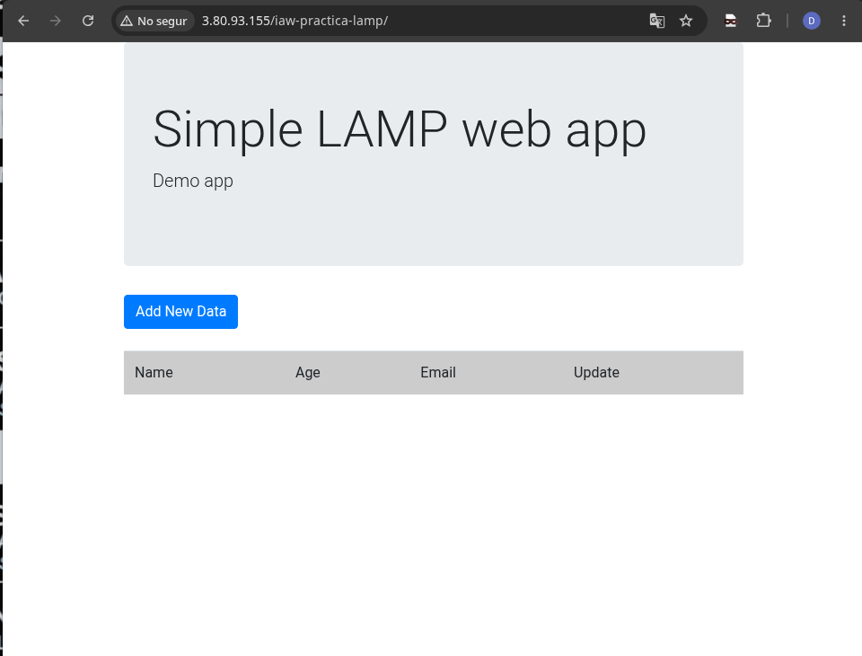
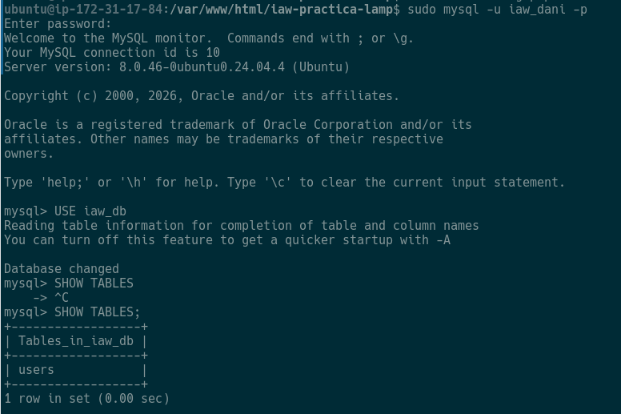
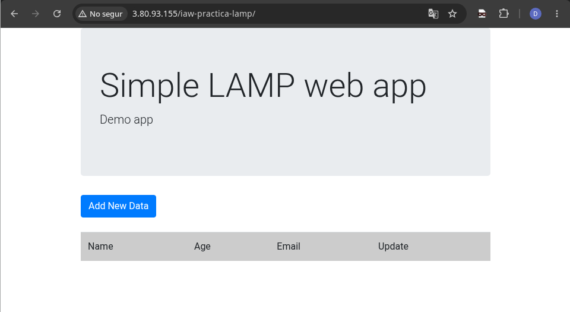
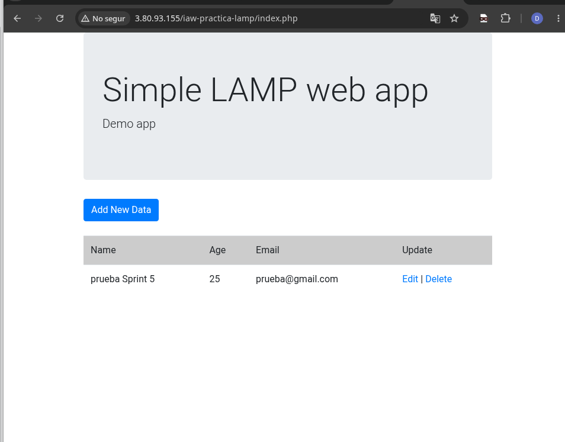

 # Sprint · Despliegue de una aplicación web LAMP sencilla
Implantación de Aplicaciones Web · 2.º ASIX

---

## 1. Evidencias

### E1 · Aplicación publicada
Captura del navegador mostrando la aplicación funcionando correctamente.

**¿Qué camino sigue una petición desde el navegador hasta que recibes la respuesta?**
> El navegador realiza una petición HTTP a la dirección IP pública de la instancia EC2. Apache la recibe por el puerto 80, PHP interpreta el código fuente de la aplicación, interactúa con la base de datos MySQL para consultar o modificar la información, y Apache devuelve la respuesta final formateada en HTML para que el navegador la renderice al usuario.

---

### E2 · Base de datos preparada
Captura de MySQL donde se visualiza la base de datos utilizada y sus tablas principales.

**¿Por qué necesita la aplicación esta estructura de base de datos?**
> La aplicación necesita esta base de datos y sus tablas estructuradas para almacenar de manera persistente los registros gestionados desde la interfaz web, permitiendo guardar, consultar y actualizar la información de forma dinámica.

---

### E3 · Configuración de la conexión

| Parámetro | Valor o función |
| :--- | :--- |
| **DB_HOST** | localhost |
| **DB_NAME** | iaw_db |
| **DB_USER** | iaw_dani |
| **DB_PASSWORD** | Configurada, no se publica por seguridad |

**¿Por qué localhost es una opción coherente en esta arquitectura?**
> Es coherente porque utilizamos una arquitectura monolítica de un único servidor donde todos los componentes de la pila LAMP (Apache, PHP y MySQL) se ejecutan dentro de la misma instancia EC2, permitiendo una comunicación local directa y eficiente.

---

### E4 · CRUD verificado
Prueba de inserción y modificación de datos en la aplicación.

**Estado antes de la operación:**

**Estado después de la operación:**

**¿Qué demuestra esta prueba sobre la relación entre PHP y MySQL?**
> Demuestra que la comunicación de extremo a extremo es totalmente funcional: PHP procesa correctamente los formularios enviados por el usuario, ejecuta las consultas SQL de inserción o actualización en MySQL, y los datos persisten correctamente en la base de datos reflejándose en la interfaz.

---

## 2. Preguntas de comprensión

1. **¿Por qué no es suficiente con que Apache esté funcionando para afirmar que la aplicación completa funciona?**
   > Porque Apache solo gestiona el servidor web y sirve ficheros estáticos. Le hace falta la conexion y union de datos con php y mysql.

2. **¿Qué papel realiza PHP entre Apache y MySQL?**
   > Apache le pide los datos a php, php lo convierte en un codigo que lo pasa a mysql para realizar los cambios mysql vuelve a pasar el codigo a php luego le manda el resultado a apache que es el que finalmente cambia la informacion del html.

3. **¿Qué ocurrirá si DB_USER o DB_PASSWORD no coinciden con los datos configurados en MySQL?**
   > La conexión será rechazada por seguridad y la aplicación generará un error de acceso denegado .

4. **¿Por qué utilizamos localhost en este Sprint para conectar PHP con MySQL?**
   > Porque ambos servicios residen en la misma máquina virtual (EC2), por lo que la comunicación se realiza de forma local mediante bucle local .

5. **La página principal se carga, pero aparece un error al consultar datos. ¿Qué tres comprobaciones realizarías primero y en qué orden?**
   > 1. Revisar el fichero de configuración de la conexión (credenciales y host).
   > 2. Comprobar que el servicio MySQL está activo 'systemctl'.
   > 3. Revisar los logs de error de Apache y PHP para identificar el fallo exacto en la consulta SQL.

6. **¿Por qué una prueba CRUD es una evidencia más completa que limitarse a comprobar que MySQL está activo?**
   > Porque una prueba CRUD valida que todo lo que hemos hecho funciona correctamente desde principio a final
